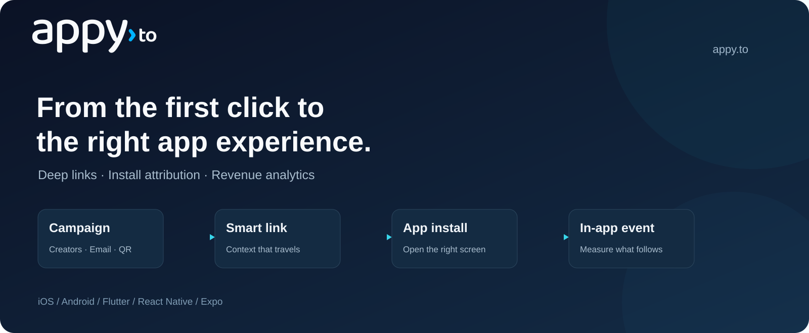

# react-native-appy



**[Start here: short installation guide](QUICKSTART.md)** · [Which names and values do I replace?](SETUP.md)

> **Source preview:** this package is not published to npm yet. [Build the included example from source](SOURCE_SETUP.md).

**This is a library for your own app.** Keep the `Appy` SDK/package names in code; use your own app name, identifiers, publishable key and link domain. [Get those values from the dashboard](SETUP.md).

`react-native-appy` connects a React Native or Expo app to [Appy](https://appy.to) smart links and QR codes on iOS and Android:

- **Deep links.** Universal Links and App Links on your Appy link domain, and custom-scheme links opened by the Appy redirect page, arrive as an `AppyDeepLink` with the slug, the in-app destination and the link's parameters.
- **Deferred deep links.** A link tapped before the app was installed is delivered on the first launch after install, through the same listener.
- **Install attribution.** The first launch tells you which link, campaign or ad network brought the install, or that it was organic.
- **Events.** In-app events and revenue, de-duplicated by your purchase ID and credited to the link that brought the install.
- **Share links.** `https://<your-domain>/<slug>?…` URLs for links in your account.

The package is an [Expo module](https://docs.expo.dev/modules/overview/) over the native [Appy iOS SDK](https://appy.to/docs/sdk/ios) and [Appy Android SDK](https://appy.to/docs/sdk/android). It works in Expo apps and in bare React Native apps, and comes with a config plugin that sets up Associated Domains and Android App Links from `app.json`.

## Requirements

- Expo SDK 54 or later (tested with SDK 58 and React Native 0.88). Bare React Native apps need the `expo` package, added with `npx install-expo-modules@latest`.
- iOS 15.1 or later, Android 5.0 (API 21) or later.
- A development build. Expo Go cannot load the native code.
- An app registered with Appy and its publishable key (`appy_pk_…`). The SDK endpoints are part of the Appy Enterprise plan; keys on other plans receive `403 plan_required`, which the first launch reports as `{ status: 'failed', error: 'invalidResponse' }`.

## Install

This is currently a **source preview**. Follow [Build the example from source](SOURCE_SETUP.md) to download this package and its native dependencies. A one-command registry install is not available yet.

After that source setup, the sections below explain how to connect the SDK to your app. Keep the existing native dependency setup from the source guide.

## 1. Register your app

Open **Apps & SDK → New app** in the [Appy dashboard](https://appy.to). Enter your own app name, choose its link subdomain, and select the platforms you ship:

- **iOS:** your Apple Team ID and the Bundle ID from Xcode.
- **Android:** your `applicationId` and the SHA-256 fingerprints of the signing certificates used for your builds, including Play App Signing for Play Store builds.

Select **Register app**. Open **SDK setup** on the app's page and copy the **Publishable key** and **Link domain**. One dashboard app can contain both platforms. [Where to find every value](SETUP.md).

In the examples, replace `YOUR_PUBLISHABLE_KEY` and `your-app.appy.to` with those copied values. Keep the `Appy` class names and package/import names. You do not need a secret API key or a terminal registration request.

## 2. Add the config plugin (Expo)

In `app.json`, set your URL scheme and add the plugin with your link domains:

```json
{
  "expo": {
    "scheme": "yourapp",
    "plugins": [
      ["react-native-appy", { "linkDomains": ["your-app.appy.to"] }]
    ]
  }
}
```

Then build again with `npx expo prebuild` or EAS Build. The plugin:

- adds `applinks:your-app.appy.to` to the iOS Associated Domains entitlement;
- adds an `autoVerify` App Link intent filter for `https://your-app.appy.to` to the main Android activity;
- connects the iOS `AppySDK` dependency; in the source preview it uses the neighboring iOS SDK checkout;
- excludes the SDK's state from Android Auto Backup, so a reinstall still gets its first launch. If your app already sets backup rules, prebuild prints a warning with the line to add.

| Option | Default | Meaning |
|---|---|---|
| `linkDomains` | required | Hosts of your Appy links. |
| `ios.developerMode` | `false` | Also add `applinks:<domain>?mode=developer`, so development builds fetch the association file directly from Appy. |
| `android.excludeFromBackup` | `true` | Add the backup rules described above. |

The `scheme` gives in-app browsers that ignore Universal Links (Instagram, Facebook, many mail apps) a way back into your app: the Appy redirect page opens `yourapp://…?appy_click_id=…`.

## 2b. Bare React Native

Without prebuild, make the same changes yourself:

1. In Xcode, add the **Associated Domains** capability with `applinks:your-app.appy.to`, and your URL scheme under **Info > URL Types**.
2. Add this line inside your app target in `ios/Podfile`, then run `pod install` in `ios/`:

   ```ruby
   pod 'AppySDK', :git => 'https://github.com/appy-to/appy-ios-sdk.git', :tag => '1.0.0'
   ```

3. Add the App Link and custom-scheme intent filters to your main activity in `android/app/src/main/AndroidManifest.xml`, as in the [Android guide](https://appy.to/docs/sdk/android#intent-filters), and the backup rules from [Keep the first launch a first launch](https://appy.to/docs/sdk/android#keep-the-first-launch).

Links reach the SDK without further native code: the package listens to the app delegate on iOS, including scene events that `ExpoAppDelegate` forwards, and to the React activity on Android. Your `AppDelegate` must subclass `ExpoAppDelegate`, which `install-expo-modules` sets up.

## 3. Configure

Call `configure` once, as early as possible, at module scope of your app's entry file (`app/_layout.tsx` with Expo Router, `App.tsx` or `index.js` otherwise):

```ts
import Appy from 'react-native-appy';

Appy.configure({
  publishableKey: 'YOUR_PUBLISHABLE_KEY',
  linkDomains: ['your-app.appy.to'],
  logLevel: __DEV__ ? 'debug' : 'error',
});
```

| Option | Default | Meaning |
|---|---|---|
| `publishableKey` | required | Your `appy_pk_…` key. Never ship a secret key (`appy_sk_…`). |
| `linkDomains` | `[]` | Hosts of your Appy links. The first one is used by `buildLink`. |
| `emailLinkDomains` | `[]` | Click-tracking domains of your email tool that open the app. The native SDKs resolve their links to the destination, as described in the [iOS](https://appy.to/docs/sdk/ios#links-in-marketing-email) and [Android](https://appy.to/docs/sdk/android#links-in-marketing-email) guides. The config plugin does not add them: put them in `ios.associatedDomains` and `android.intentFilters` in your app config. |
| `logLevel` | `'error'` | `'none'`, `'error'`, `'warning'`, `'info'` or `'debug'`. |
| `openDeferredDeepLinks` | `false` | Let the SDK open a deferred link's in-app URL itself. See [Deferred deep links](#5-deferred-deep-links). |
| `deferredDeepLinkTimeoutMs` | `5000` | How long the first launch waits for Appy's answer before reporting `'timeout'`. |
| `launchLinkWaitMs` | `500` | How long a launch waits for a link, so a cold start from a link sends one request. |
| `requestTimeoutMs` | `10000` | Timeout per HTTP attempt. |
| `apiBaseUrl` | `https://api.appy.to` | Change only for staging. |
| `android.collectInstallReferrer` | `true` | Read the store's install referrer on the first Android launch. |
| `android.metaAppId` | none | Your Facebook App ID, to read the Meta Install Referrer. See [Install attribution](#6-install-attribution). |

Links that open the app before `configure` runs, such as the link of a cold start, are kept by the native SDK and resolved right after it. A second `configure` call in the same process, for example after a JavaScript reload, is ignored.

## 4. Handle deep links

```ts
import { useEffect } from 'react';
import { router } from 'expo-router';
import Appy from 'react-native-appy';

useEffect(() => {
  const subscription = Appy.addDeepLinkListener((result) => {
    if (result.status === 'found') {
      const item = result.link.parameters.item;
      router.push(item ? `/items/${item}` : `/campaigns/${result.link.slug}`);
    }
  });
  return () => subscription.remove();
}, []);
```

The listener receives an `AppyDeepLinkResult`:

| Result | Meaning |
|---|---|
| `{ status: 'found', link }` | An Appy link opened the app, or on the first launch Appy found the link tapped before the install (`link.isDeferred` is `true`). |
| `{ status: 'notFound' }` | First launch only. Appy answered, and no Appy link led to this install. |
| `{ status: 'failed', error }` | First launch only. `error` is `'timeout'`, `'network'` or `'invalidResponse'` (for example an invalid key). |

When it is called:

- on the first launch after install, exactly once, with one of the three results;
- every time an Appy link opens the app, cold or warm, with `'found'`;
- on no other launch.

A result that arrives while no listener is registered is kept by the native SDK and delivered once, to the next listener; when several arrive, the most recent link wins. Register the listener in a component that lives as long as the app, such as the root layout.

An `AppyDeepLink` has:

| Property | Meaning |
|---|---|
| `url` | The Appy link, for example `https://your-app.appy.to/spring?item=42` |
| `deeplinkUrl` | The in-app destination set on the link, for example `yourapp://items?item=42` |
| `slug` | The link's slug, for example `spring` |
| `parameters` | The link's query parameters, including `utm_*`, without the reserved `appy_` ones |
| `isDeferred` | `true` when the link was tapped before the app was installed |
| `clickedAt` | When the link was tapped (`Date`), if known |

When Appy cannot be reached, a link that opened the app still arrives as `'found'`, read from the URL itself: `slug` is the first path segment and `deeplinkUrl` and `clickedAt` are `null`. Make your routing work from `slug` and `parameters` too.

`Appy.getLatestDeepLink()` resolves to the most recent link, including a deferred link that arrived after the timeout.

### Expo Router and React Navigation

React Native's `Linking` also receives every link that opens the app, so Expo Router and React Navigation would try to open `/spring` for `https://your-app.appy.to/spring`. Let the Appy listener route those links and tell the router to ignore them. With Expo Router, add `app/+native-intent.tsx`:

```ts
import { isAppyLink } from 'react-native-appy';

export function redirectSystemPath({ path }: { path: string; initial: boolean }) {
  return isAppyLink(path, ['your-app.appy.to']) ? null : path;
}
```

`isAppyLink(url, linkDomains?)` returns `true` for URLs on your link domains and for any URL with `appy_click_id`. Without the second argument it uses the link and email link domains passed to `configure`; with it, list your email link domains there too. With React Navigation, apply the same check in `linking.getInitialURL` and `linking.subscribe`.

**Links from push notifications, in-app messages or QR scanners** reach your code as a URL. Pass it to `Appy.handleUrl`; an Appy link then arrives on the listener and counts as an app open:

```ts
if (!(await Appy.handleUrl(url))) {
  router.push(url);
}
```

## 5. Deferred deep links

When someone taps an Appy link without your app installed, Appy remembers the tap and sends them to the store. On the first launch after install the package asks Appy for that link, and the listener receives `'found'` with `isDeferred === true`, or `'notFound'` for an organic install. On Android the store's install referrer carries the link; on iOS Appy matches the install to the tap. The answer comes within `deferredDeepLinkTimeoutMs`, counted from `configure`; until Appy has answered a first launch, later launches ask again.

With `openDeferredDeepLinks: true`, the SDK also opens the deferred link's `deeplinkUrl` (for example `yourapp://items?item=42`) after calling the listener. Your router receives it through `Linking` like any other link to your scheme, so route deferred links either in the listener or through your router, not both. The SDK opens only URLs your app registered, so it never sends the user to a browser.

To test, delete the app, tap an Appy link on the same device, install your development build and open it. Every install gets a new random install ID, so there is nothing to reset.

## 6. Install attribution

```ts
Appy.addAttributionListener((attribution) => {
  analytics.setUserProperty('acquisition', attribution.isOrganic ? 'organic' : attribution.campaign ?? attribution.linkSlug);
});

const stored = await Appy.getAttribution();
```

The listener is called once, when Appy answers the first launch, also when that answer came after the deep link timeout. `getAttribution()` resolves to the stored value on every later launch, or `null` until Appy has answered.

| Property | Meaning |
|---|---|
| `isOrganic` | `true` when no Appy link or ad network led to the install |
| `linkSlug`, `linkTitle` | The link that brought the install |
| `source`, `medium`, `campaign` | The `utm_source`, `utm_medium` and `utm_campaign` of the tapped link |
| `clickedAt` | When the link was tapped |
| `network` | Set when an ad network attributed the install instead of an Appy link: `name` (`google_ads`, `meta`), campaign, ad group, ad, `clickId` and `touch` |

- **Apple Ads**: on iOS 14.3 and later the iOS SDK sends the AdServices attribution token on the first launch. Nothing to configure; the result appears on the install in the dashboard and in install postbacks.
- **Google Ads**: a `gclid` in the Play install referrer marks the install as Google Ads. Nothing to configure.
- **Meta**: set `android: { metaAppId: '<Facebook App ID>' }` in `configure` and add the Install Referrer decryption key to your app in the Appy dashboard.

Attribution on the device is for analytics and personalization. Before you grant a referral reward, look the install up from your backend and check `attribution.verified`; see [Install attribution](https://appy.to/docs/attribution).

## 7. Track events

```ts
Appy.track('signup');
Appy.track('add_to_cart', { properties: { sku: 'A1', qty: 2, gift: false } });
Appy.track('purchase', {
  properties: { sku: 'A1' },
  revenue: 19.98,
  currency: 'USD',
  deduplicationId: purchase.transactionId,
});
```

- Names are 1 to 64 characters. Property values are strings, finite numbers or booleans; other values are dropped. At most 50 properties, strings up to 512 characters.
- `revenue` needs a three-letter `currency`. Negative revenue (refunds) is allowed.
- `deduplicationId` is the store's transaction ID: the App Store transaction ID or the Google Play order ID. Appy counts a purchase once, even when it is tracked again after a restore or also reported by your backend with the same ID.

Events are queued on disk and sent in batches: 2 seconds after the last `track`, when 20 are waiting, when the app goes to the background, or when you call `Appy.flush()`.

## 8. Users, privacy and consent

```ts
Appy.setUserId('u_123');
Appy.setUserId(null);
```

Call it after sign-in, and with `null` on sign-out. Use an opaque internal ID, not an email address.

`Appy.setTrackingEnabled(false)` is stored across launches. While tracking is off, no launch open, deferred deep link lookup or event is sent, and links that open the app still resolve without being stored. If you ask for consent first, turn tracking off before `configure` until the user answers:

```ts
if (!consent.hasAnswered) {
  Appy.setTrackingEnabled(false);
}
Appy.configure(configuration);

consent.onAnswer((granted) => Appy.setTrackingEnabled(granted));
```

When tracking turns on, the first-launch lookup starts and the deep link and attribution listeners follow. The SDKs read no advertising ID, show no App Tracking Transparency prompt and ship a privacy manifest on iOS. Data handling is described in the [iOS](https://appy.to/docs/sdk/ios#privacy-and-consent) and [Android](https://appy.to/docs/sdk/android#privacy-and-consent) guides.

## 9. Share links

```ts
const url = await Appy.buildLink('spring', { ref: referralCode });
```

This resolves to `https://your-app.appy.to/spring?ref=…` on the first link domain, or `null` before `configure`, without a link domain, or for an invalid slug. The slug must belong to a link in your account.

## 10. Debugging

Set `logLevel: 'debug'`. On Android run `adb logcat -s Appy`; on iOS filter the Xcode console or Console.app on `subsystem:to.appy.sdk`.

```bash
xcrun simctl openurl booted "https://your-app.appy.to/spring?item=42"
adb shell 'am start -W -a android.intent.action.VIEW -c android.intent.category.BROWSABLE -d "https://your-app.appy.to/spring?item=42"'
```

| Symptom | Check |
|---|---|
| `Cannot find native module 'Appy'` | You are in Expo Go or an old build. Build a development build after installing the package. |
| Links open the browser | The AASA file or `assetlinks.json` for your domain, the Team ID or SHA-256 fingerprint of the build you run, and the entitlement and intent filter the plugin added. |
| The router opens an unmatched route | Add `+native-intent.tsx` as shown above. |
| The listener is never called | `configure` runs at startup, the domain is in `linkDomains`, and a listener is registered. |
| `{ status: 'failed', error: 'invalidResponse' }` | HTTP 401 or 403 in the log: the publishable key, or a plan without SDK access. |

## API reference

| Function | |
|---|---|
| `configure(configuration)` | Starts the SDK. Call once, early. |
| `addDeepLinkListener(listener)` | Receives every `AppyDeepLinkResult`. Returns a subscription with `remove()`. |
| `addAttributionListener(listener)` | Receives the install's `AppyAttribution`, once per install. |
| `getAttribution()` | The stored install attribution, or `null`. |
| `getLatestDeepLink()` | The most recent link, or `null`. |
| `handleUrl(url)` | Resolves an Appy link received another way; `false` for other URLs. |
| `isAppyLink(url, linkDomains?)` | Whether a URL is an Appy link, for routers. |
| `track(name, { properties, revenue, currency, deduplicationId })` | Queues an event. |
| `setUserId(userId)` | Sets or clears the user ID. |
| `setTrackingEnabled(enabled)`, `isTrackingEnabled()` | Stored opt-out, on by default. |
| `buildLink(slug, parameters?)` | Builds a share link. |
| `flush()` | Sends queued events now. |
| `nativeSdkVersion()` | The version of the native SDK in the app. |
| `pluginVersion` | This package's version. |

Every function is also a named export, and the default export `Appy` groups them.

## Versions

| `react-native-appy` | Appy iOS SDK | Appy Android SDK | Expo SDK |
|---|---|---|---|
| 1.0.0 | 1.0.x | 1.0.x | 54 or later |

## License

MIT. See [LICENSE](LICENSE).

## Third-party licensing

The Appy source in this repository uses the [MIT license](LICENSE). Third-party libraries and platform SDKs keep their own licenses. The Android implementation depends on `com.android.installreferrer:installreferrer:2.2`; its published POM identifies the [Android Software Development Kit License](https://developer.android.com/studio/terms). Obtain it from Google's Maven repository and retain applicable notices; the Appy MIT license does not relicense this dependency.
